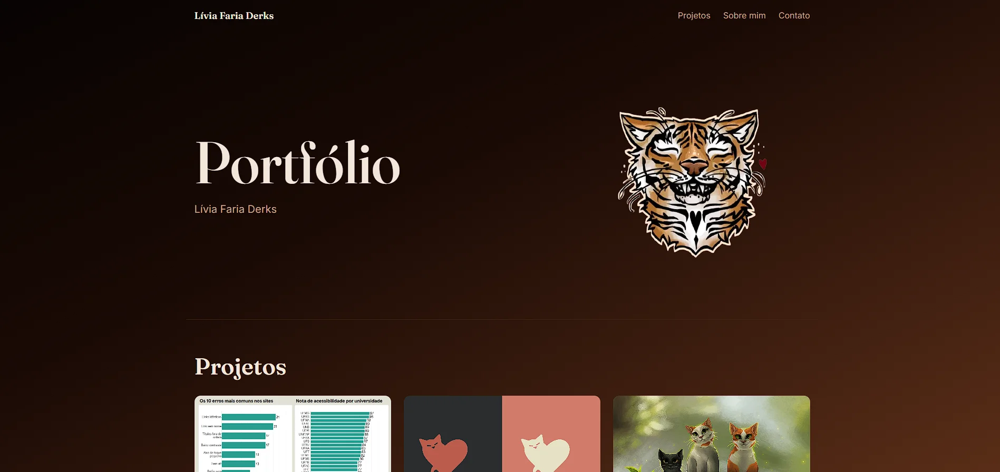

# Portfólio · Lívia Derks

Meu portfólio pessoal, onde reúno projetos de **UX e acessibilidade**, **design gráfico** e **desenhos digitais**.

🔗 **Ver o site:** portfolio-liviadks.vercel.app/



## O que tem aqui

| Página | Conteúdo |
| --- | --- |
| [Início](index.html) | Apresentação, lista de projetos, sobre mim e contato |
| [Acessibilidade nos sites das universidades federais](acessibilidade.html) | Estudo de caso: testei a página inicial de 27 universidades federais com Lighthouse e WAVE e organizei os resultados em um dashboard no Looker Studio |
| [Design gráfico](design.html) | Estampa Terceirão, banners da Papelaria Plug, layout do EcoPraia Florianópolis e identidade visual da MeowShop |
| [Desenhos digitais](desenhos.html) | Galeria de ilustrações autorais |


## Como foi feito

O site é feito só com **HTML, CSS e JavaScript puros**, sem framework e sem etapa de build.

- **Acessibilidade em primeiro lugar:** link para pular para o conteúdo, títulos em ordem, texto alternativo nas imagens e aviso nos links que abrem em nova aba.
- **Galeria com zoom** usando o elemento nativo `<dialog>`, que fecha pelo botão, pela tecla Esc ou clicando fora da imagem.
- **Imagens em WebP**, para as páginas carregarem mais rápido.
- **Tipografia:** Fraunces nos títulos e Inter no texto, pelo Google Fonts.
- **Cores e medidas centralizadas** em variáveis CSS no `base.css`.

## Estrutura

```
├── index.html            # página inicial
├── acessibilidade.html   # estudo de caso de acessibilidade
├── design.html           # projetos de design gráfico
├── desenhos.html         # galeria de desenhos
├── css/
│   ├── base.css          # variáveis, reset e estilos comuns
│   ├── home.css          # página inicial
│   ├── galeria.css       # páginas de galeria
│   └── estudo.css        # página do estudo de caso
├── js/
│   └── galeria.js        # zoom das imagens
└── assets/
    ├── docs/             # currículo em PDF
    └── img/              # imagens dos projetos, organizadas por página
```

## Rodar localmente

Não precisa instalar nada. Basta clonar e abrir o `index.html` no navegador:

```bash
git clone https://github.com/liviadks/Portfolio-design.git
cd Portfolio-design
```

Se preferir um servidor local (por exemplo, com a extensão Live Server do VS Code ou com Python):

```bash
python3 -m http.server
```

e acessar `http://localhost:8000`.

## Contato

- [LinkedIn](https://www.linkedin.com/in/l%C3%ADviadks/)
- [GitHub](https://github.com/liviadks)
- [Currículo](https://meu-curriculo-roan.vercel.app/)

---

Os desenhos e peças de design deste repositório são de minha autoria. Por favor, não reutilize sem pedir. 🙂
